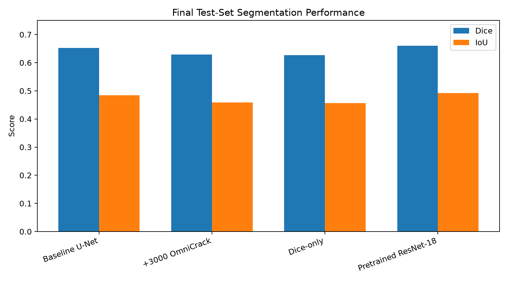
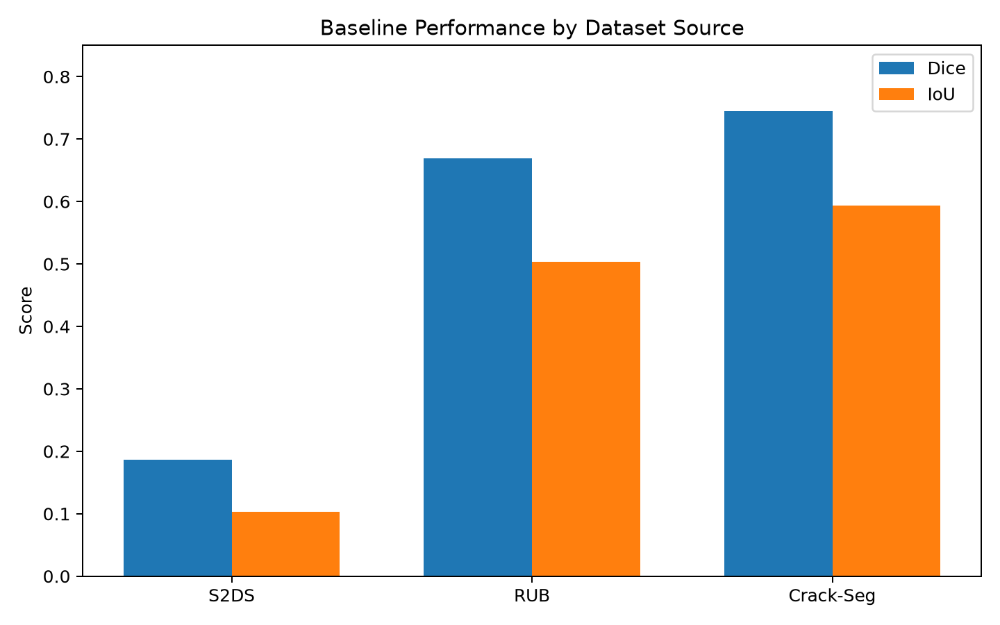

# Crack Detection with U-Net

A semantic segmentation project for detecting surface cracks using U-Net architectures.

The project covers the complete machine learning pipeline:

- Dataset preparation and standardization
- Binary semantic segmentation
- Data augmentation
- U-Net implementation
- Loss function experimentation
- Transfer learning with a pretrained ResNet-18 encoder
- Dataset composition experiments
- Validation and test-set evaluation
- Source-wise performance analysis
- Qualitative segmentation analysis


## 1. Project Overview

The objective of this project is to perform **binary semantic segmentation of surface cracks**.

Unlike image classification, where a model predicts a class for an entire image, semantic segmentation predicts a class for every pixel.

The target task contains two classes:

```text
0   → Background
255 → Crack
````

The model receives an RGB image and produces a single-channel segmentation mask.


# 2. Dataset

The project uses three primary crack segmentation datasets:

* S2DS
* BochumCrackDataset (RUB)
* Crack-Seg

A fourth dataset, **OmniCrack30k**, is prepared separately and used as an auxiliary dataset for controlled experiments.

The primary datasets were converted into a common binary image-mask representation so that they could be used by the same training pipeline.

## 2.1 Initial Dataset State

The datasets originally use different annotation formats and conventions.

| Dataset            | Annotation             | Original Resolution | Splits              |
| ------------------ | ---------------------- | ------------------: | ------------------- |
| S2DS               | Pixel-wise annotations |         1024 × 1024 | Train / Val / Test  |
| BochumCrackDataset | Grayscale masks        |           512 × 512 | No predefined split |
| Crack-Seg          | YOLO-style polygons    |           416 × 416 | Train / Val / Test  |
| OmniCrack30k       | Pixel-wise masks       |           256 × 256 | Train / Val / Test  |

Because the datasets use different formats and class definitions, preprocessing was required before they could be used together.

# 3. Dataset Preparation

The objective of preprocessing was to convert the datasets into a common representation.

The preprocessing was performed separately for each dataset.

## 3.1 S2DS

S2DS contains several types of structural defects, including:

* Cracks
* Spalling
* Corrosion
* Efflorescence
* Vegetation
* Control points
* Background

Since the target task is specifically **crack segmentation**, only the crack class is retained as foreground.

All other classes are mapped to background:

```text
Crack          → 255
Spalling       → 0
Corrosion      → 0
Efflorescence  → 0
Vegetation     → 0
Control points → 0
Background     → 0
```

Images containing other types of defects were **not removed**.

This is intentional because such images provide negative examples. They allow the model to learn that other structural defects should not automatically be classified as cracks.

S2DS already provides predefined train, validation, and test splits, so those splits were preserved.

## 3.2 BochumCrackDataset (RUB)

The BochumCrackDataset contains **370 images** with corresponding grayscale segmentation masks.

The original masks already follow the desired binary convention.

Unlike S2DS and Crack-Seg, RUB does not provide predefined train, validation, and test splits.

Therefore, the dataset was randomized and divided into: Train, Validation, Test.


A fixed random seed was used so that the split remains reproducible.

The randomization was performed before splitting to avoid depending on the original ordering of the dataset.

## 3.3 Crack-Seg

Crack-Seg provides predefined train, validation, and test splits, which were preserved.

The main difference is its annotation format.

Instead of providing pixel-wise masks, Crack-Seg provides YOLO-style segmentation annotations in `.txt` files.

The annotations contain polygon coordinates describing crack regions.

These polygons were converted into pixel-wise binary masks:

```text
0   → Background
255 → Crack
```

The generated masks were then stored alongside their corresponding images using the unified dataset structure.

# 4. Unified Dataset

After preprocessing, all three primary datasets use the same image-mask representation.

The final structure is:

```text
Brix_dataset/
├── train/
│   ├── images/
│   └── masks/
├── val/
│   ├── images/
│   └── masks/
└── test/
    ├── images/
    └── masks/
```

Images and masks are stored in separate directories.

Each image and its corresponding mask share the same base filename.

For example:

```text
train/images/rub_00042.png
train/masks/rub_00042.png
```

The source dataset is preserved using filename prefixes.
For example:

```text
s2ds_00000.png
rub_00000.png
crackseg_00000.jpg
```

This makes it possible to perform source-wise evaluation after training.

# 5. Image Resolution

The primary datasets have different original resolutions:

```text
S2DS                → 1024 × 1024
BochumCrackDataset  → 512 × 512
Crack-Seg           → 416 × 416
```

The original resolutions are preserved during dataset preparation.

Images are resized later by the training pipeline to a common input size of:

```text
256 × 256
```

This separation between dataset preparation and training preprocessing makes it possible to experiment with different training resolutions without recreating the dataset.

When resizing an image and its mask, the same spatial transformation must be applied to both.

Different interpolation methods are used:

```text
Image → Bilinear interpolation
Mask  → Nearest-neighbor interpolation
```

Nearest-neighbor interpolation is important for masks because interpolation methods such as bilinear interpolation could introduce intermediate pixel values and corrupt the segmentation labels.

Downsampling also has an important consequence for this task: cracks can be very thin structures, so reducing image resolution may remove or weaken fine crack information.

# 6. OmniCrack30k

OmniCrack30k was prepared as an **auxiliary dataset** rather than immediately being merged with the primary dataset.

It contains a large number of crack image-mask pairs and provides predefined train, validation, and test splits.

## 6.1 Annotation Conversion

The original OmniCrack30k masks use the opposite pixel convention:

```text
Original:

Background → White
Crack      → Black
```

The masks were therefore inverted during preprocessing.

After conversion:

```text
Background → 0
Crack      → 255
```

This makes OmniCrack30k compatible with the primary dataset format.

The original image-mask filename relationships were preserved, and a mapping file was retained during conversion.

## 6.2 Organization

The prepared OmniCrack30k dataset uses the same general structure:

```text
omnicrack30/
├── train/
│   ├── images/
│   └── masks/
├── val/
│   ├── images/
│   └── masks/
└── test/
    ├── images/
    └── masks/
```
# 7. Dataset Statistics

The final primary dataset contains:

| Split      | Image/Mask Pairs |
| ---------- | ---------------: |
| Train      |            4,539 |
| Validation |              342 |
| Test       |              261 |

The training set contains images with both positive and empty masks.

This is useful because the model should learn both:

```text
Image containing crack
```

and:

```text
Image without annotated crack
```

# 8. Model Architecture

## 8.1 Baseline U-Net

The baseline model is a standard U-Net.

It consists of:

* Encoder blocks
* Max-pooling layers
* Decoder blocks
* Transposed convolutions
* Skip connections
* A final `1 × 1` convolution

The encoder progressively reduces the spatial resolution while increasing the number of feature channels.

The decoder progressively restores the spatial resolution.

Skip connections transfer spatial information from the encoder to the decoder.

The baseline model contains approximately:

```text
31 million parameters
```

The output is a logit map. A sigmoid function converts the logits into probabilities during evaluation.

# 9. Pretrained ResNet-18 Encoder

A second U-Net-style architecture uses a pretrained **ResNet-18** encoder.

The ResNet-18 encoder was initialized with ImageNet-pretrained weights.

The decoder remains a U-Net-style decoder with skip connections.


ImageNet normalization is applied to the input before passing it through the pretrained encoder.

# 10. Loss Functions

## 10.1 Binary Cross Entropy

Binary Cross Entropy provides pixel-level classification supervision.

The implementation uses `BCEWithLogitsLoss`, which combines the sigmoid operation and binary cross entropy in a numerically stable form.

## 10.2 Dice Loss

Dice Loss is based on the Dice coefficient.

The corresponding loss is:

```text
Dice Loss = 1 - Dice
```

## 10.3 BCE + Dice

The main experiments use:

```text
Loss = BCE + Dice
```

The motivation is to combine pixel-level classification with an overlap-based objective.

This is particularly relevant to crack segmentation because cracks often occupy a relatively small fraction of the image.

# 11. Evaluation Metrics

Two main segmentation metrics are used.

## Dice Score

```text
                 2 × Intersection
Dice = -------------------------------------
       Prediction Area + Target Area
```

A value of `1.0` indicates perfect overlap.

## Intersection over Union

```text
             Intersection
IoU = ---------------------------
       Prediction ∪ Ground Truth
```

A value of `1.0` indicates perfect overlap.

For the headline test results, intersections and unions are aggregated over the complete test set before calculating the final metrics.


# 12. Experiments

Four main experiments were performed.

## Experiment 1 — Baseline U-Net

Configuration:

```text
Training samples: 4,539
Image size:       256 × 256
Batch size:       4
Epochs:           10
Optimizer:        Adam
Learning rate:    1e-3
Loss:             BCE + Dice
Encoder:          Standard U-Net encoder
```

Results:

```text
Validation Dice: 0.6017
Validation IoU:  0.4896

Test Dice:       0.6525
Test IoU:        0.4843
```

## Experiment 2 — +3,000 OmniCrack30k Images

The primary training set was extended with 3,000 images from the OmniCrack30k training set.

```text
Original training set:
4,539

Extended training set:
7,539
```

The validation and test sets remained unchanged.

Results:

```text
Validation Dice: 0.5924
Validation IoU:  0.4828

Test Dice:       0.6286
Test IoU:        0.4583
```

In this experiment, adding 3,000 OmniCrack30k images did not improve performance on the held-out primary test set.

This result should not be interpreted as evidence that additional data is inherently harmful. The experiment only measures the effect under this particular dataset composition, training configuration, and random initialization.


## Experiment 3 — Dice-only Loss

The baseline architecture and dataset were retained while replacing:

```text
BCE + Dice
```

with:

```text
Dice
```

Results:

```text
Validation Dice: 0.5823
Validation IoU:  0.4702

Test Dice:       0.6272
Test IoU:        0.4569
```

Under this setup, Dice-only loss produced lower validation and test performance than the BCE + Dice configuration.

## Experiment 4 — Pretrained ResNet-18

The standard U-Net encoder was replaced with an ImageNet-pretrained ResNet-18 encoder.

Other major training settings were kept consistent with the baseline.

Results:

```text
Validation Dice: 0.6375
Validation IoU:  0.5287

Test Dice:       0.6598
Test IoU:        0.4923
```

The test performance changed from:

```text
Baseline:
Dice = 0.6525
IoU  = 0.4843
```

to:

```text
Pretrained ResNet-18:
Dice = 0.6598
IoU  = 0.4923
```

This represents a modest improvement in this particular experiment.

# 13. Experiment Summary

| Experiment           | Train Samples | Loss       | Encoder   | Val Dice | Val IoU | Test Dice | Test IoU |
| -------------------- | ------------: | ---------- | --------- | -------: | ------: | --------: | -------: |
| Baseline U-Net       |         4,539 | BCE + Dice | U-Net     |   0.6017 |  0.4896 |    0.6525 |   0.4843 |
| +3,000 OmniCrack     |         7,539 | BCE + Dice | U-Net     |   0.5924 |  0.4828 |    0.6286 |   0.4583 |
| Dice-only            |         4,539 | Dice       | U-Net     |   0.5823 |  0.4702 |    0.6272 |   0.4569 |
| Pretrained ResNet-18 |         4,539 | BCE + Dice | ResNet-18 |   0.6375 |  0.5287 |    0.6598 |   0.4923 |




# 14. Source-wise Evaluation

The baseline model was evaluated separately on each source dataset.

| Source    |   Dice |    IoU |
| --------- | -----: | -----: |
| S2DS      | 0.1866 | 0.1029 |
| RUB       | 0.6696 | 0.5033 |
| Crack-Seg | 0.7449 | 0.5935 |




The difference between sources is substantial.

The baseline performed considerably differently depending on the source dataset, particularly on S2DS.

Possible contributing factors include:

* Different image appearance
* Different crack characteristics
* Annotation differences
* Original image resolution
* Dataset-specific visual distributions

The source-wise results demonstrate why evaluating only on a single aggregate metric can hide important dataset-specific behavior.


# 15. Limitations

## Computational Resources

The experiments were performed on CPU.

This limited the number of experiments, training epochs, and possible hyperparameter searches.

## Annotation Quality

Some images may contain visually plausible crack structures that are not represented in the ground-truth annotation.

Consequently, a prediction can sometimes appear visually reasonable while receiving a lower metric score because it differs from the annotation.

# 16. What I Learned

This project provided practical experience with the complete workflow of a computer vision segmentation project.

In particular:

* Preparing datasets with different annotation formats
* Converting annotations into a unified representation
* Handling binary segmentation masks
* Building a U-Net from scratch
* Implementing segmentation losses
* Handling class imbalance
* Applying synchronized image/mask augmentation
* Using transfer learning for segmentation
* Evaluating models using Dice and IoU

# 17. License

The code in this repository is intended for educational and research purposes.

The datasets used by this project are subject to their respective licenses and are not redistributed with this repository.

